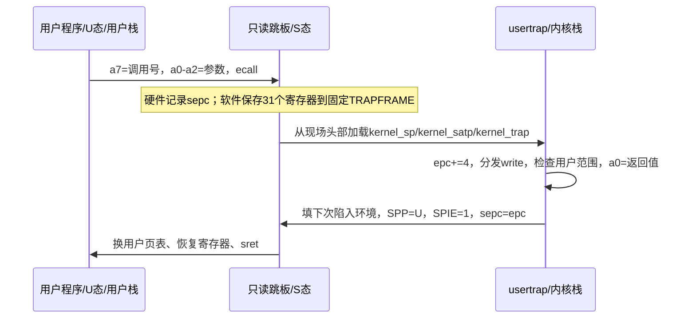
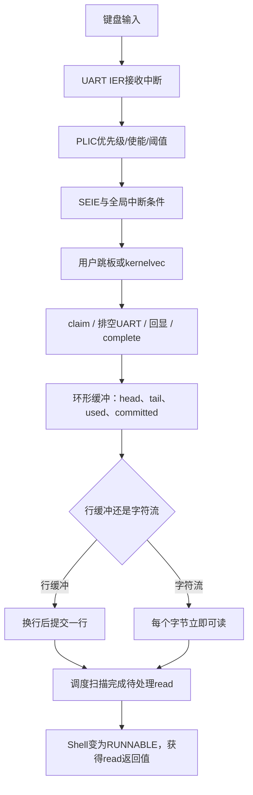

# lab2：陷入、系统调用与中断控制台

学号 2024302111042；LAB2_TICK=2、LAB2_BUF_SEMANTICS=0、LAB2_BUF_SIZE=96。
实验在单核 QEMU virt / RV64 上运行，其余 hart 停驻；使用 QEMU 的 Sstc 定时器扩展。

## 动手前的设计与测试约定

预先约定的测试：非法调用90..99均返回-1；空read阻塞但UART中断仍工作；
read长度等于96；行模式未换行不可返回、字符模式单字节可返回；超长行、
环形回绕、fork/exec/wait、用户坏地址、spin期间中断与时间片，及lab1 Banner回归。

## 实现选择与边界

- 赠送的 trampoline.S 固定访问高地址 TRAPFRAME；用户程序链接于0。因此采用最小
  Sv39映射满足赠送ABI，保持 gifts 与 user 内赠送件原样，不尝试把平铺文件当作任意可重定位代码。
- 内核恒等映射RAM/MMIO，同时映射高位TRAMPOLINE；每进程独立的用户页、页表、
  trapframe和内核栈。用户物理页从链接符号kernel_end/end之后分配，不覆盖内核。
- 用户地址空间暂固定64KB，末尾为栈；用户页暂RWX，不实现ELF权限细分、文件系统、
  完整argv、sbrk或通用POSIX语义。未实现的系统调用一律返回-1。
- fork复制用户页与寄存器；exit变为僵尸；wait回收并返回退出状态；单核按
  LAB2_TICK定时轮转。阻塞read/wait保存为待完成操作，不保存C函数调用栈，
  调度器扫描条件；无可运行进程时开中断wfi。这是lab4完整sleep/wakeup前的过渡实现。
- 环形下标始终对容量取模，以used/committed计数区分空满，不依赖96整除整数回绕周期。
  行模式预留一个槽给换行，超长行多余字符丢弃且不回显，换行仍可提交；流模式
  可用完整容量。所有缓冲区访问在单核关中断时进行；支持CR转LF、退格。
- 按赠送gets保留换行的实际行为，exec仅移除名称尾部CR/LF，不擅自修改只读Shell。
- 内嵌表实际把每项描述符与二进制交错排列，下一项位于当前end向上8字节对齐处。
- lab1带点Banner仅启动时保留；随后Shell、用户write和键盘回显使用原始字符输出。
- 原support脚本的旧`$ `提示符、fs.img依赖和累计EXPECT误匹配在工作副本中修正；
  原始文件保存在../materials，用于差异审计。

## 构建与验证

在本目录运行 `make`、`make qemu`；退出QEMU使用Ctrl-a再按x。
Shell输入hi、spin、badecall、bufstorm或selftest。spin是赠送的无限循环程序，
可用Ctrl-C终止当前前台子进程并返回Shell。
执行 `make test` 运行实机回归；测试原始赠送件的SHA-256一致性及两种输入语义。
执行 `make test-lab1` 运行独立lab1回归（需要仓库的lab1目录）。

`lab2-submit` 标记整个仓库快照；新增源码在lab2目录，lab0/lab1保持不变。
